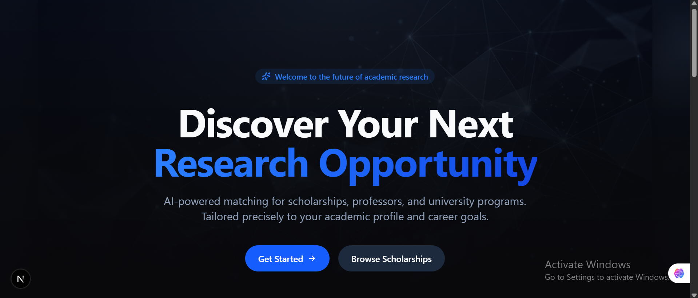
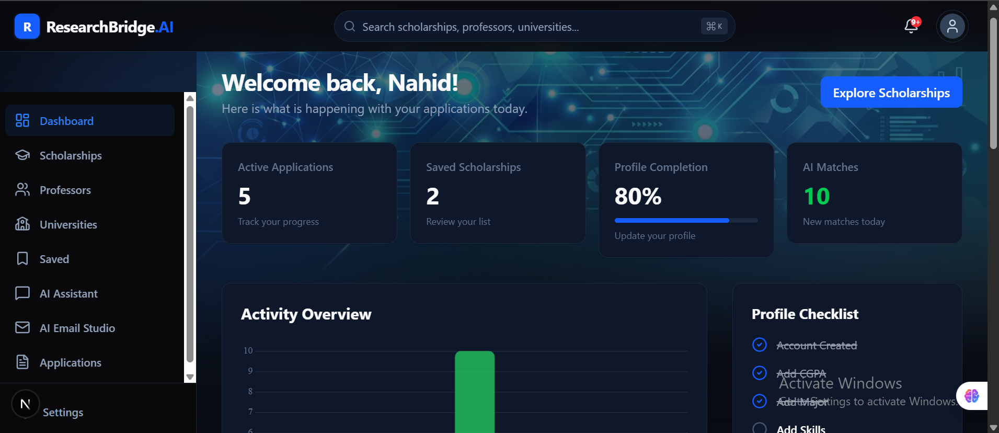
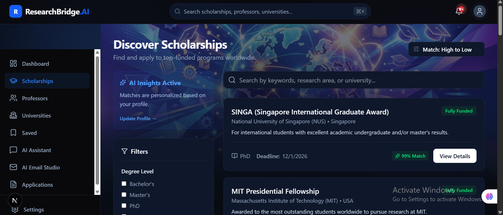
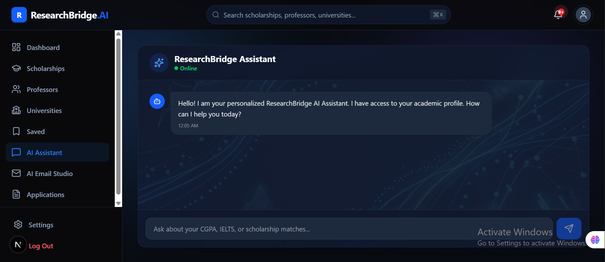
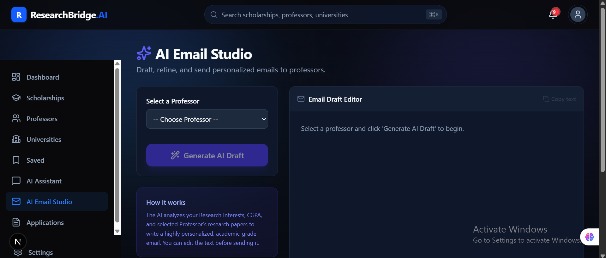
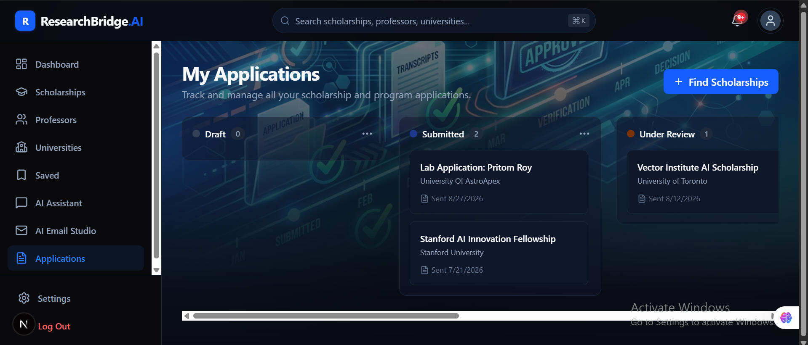
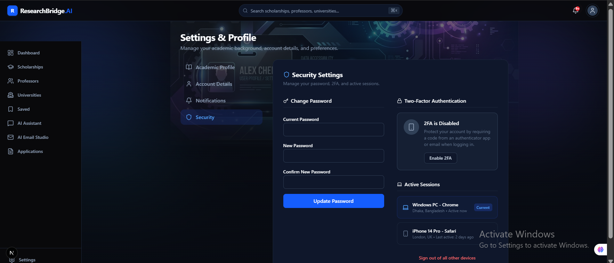

# ResearchBridge
### AI-Powered Scholarship Discovery and Academic Opportunity Platform

ResearchBridge is a platform designed to help students discover scholarship opportunities, explore universities, connect with professors, and manage academic applications through a centralized interface with AI-assisted tools.

The application brings together student-facing opportunity discovery, application tracking, professor-facing workflows, administrative management, and AI services in a modular web platform.

> **Project status:** Under active development. Features and integrations may change as the project evolves.

---

## Screenshots

The screenshots below are from the current application interface.

### Landing Page

<p align="center">
  
</p>

### Student Dashboard

<p align="center">
  
</p>

### Scholarship Discovery

<p align="center">
  
</p>

### AI Assistant

<p align="center">
  
</p>

### AI Email Studio

<p align="center">
  
</p>

### Application Tracking

<p align="center">
  
</p>

### Account and Security Settings

<p align="center">
  
</p>

---

## Project Overview

Finding relevant scholarships and academic opportunities can require students to search across multiple websites, review eligibility requirements, investigate universities, and contact academic professionals through separate channels.

ResearchBridge aims to make this process more organized by providing a single platform for discovering opportunities and managing related academic activities.

The application includes distinct experiences for students, professors, and administrators. It also contains a dedicated AI services package for analysis, conversational interactions, and retrieval-augmented generation (RAG) workflows.

## Key Features

### Student Experience
- Student registration and login.
- Personalized student dashboard.
- Scholarship discovery and detailed scholarship pages.
- University discovery and university detail pages.
- Professor discovery.
- Saved scholarships.
- Scholarship application tracking and management.
- Account and profile settings.
- AI chat assistant.
- AI-assisted email drafting.

### Professor Experience
- Dedicated professor dashboard.
- Professor profile interface.
- Application management interface.

### Administration
- Administrative dashboard.
- User management.
- Scholarship management.
- University management.
- Professor management.
- Application management.

### AI Services
The `packages/ai-core` workspace contains reusable AI services, including:
- Analysis services.
- Conversational AI services.
- Retrieval-Augmented Generation (RAG) services.

The AI package uses LangChain integrations and includes dependencies for Google Gemini, Groq, and OpenAI providers. The exact provider and model used by a particular feature depend on the application's configuration.

## Technology Stack

| Area | Technologies |
|---|---|
| Frontend framework | Next.js 16 |
| UI library | React 19 |
| Language | TypeScript |
| Styling | Tailwind CSS 4 |
| Backend | Node.js, Express 5 |
| Database access | Prisma ORM and Prisma Client |
| AI orchestration | LangChain |
| AI provider integrations | Google Gemini, Groq, OpenAI |
| Validation | Zod |
| Charts | Chart.js |
| Animation | Framer Motion |
| Icons | Lucide React |
| Monorepo | npm Workspaces, Turborepo |

## Architecture and Repository Structure

ResearchBridge is organized as a monorepo. Applications and shared packages live in separate workspaces.

```text
researchbridge/
├── apps/
│   ├── web/                 # Main Next.js application
│   ├── api/                 # Express API
│   └── docs/                # Documentation application
│
├── packages/
│   ├── ai-core/             # AI analysis, chat, and RAG services
│   ├── database/            # Shared Prisma database package
│   ├── ui/                  # Shared UI components
│   ├── eslint-config/       # Shared ESLint configuration
│   └── typescript-config/   # Shared TypeScript configuration
│
├── package.json
├── turbo.json
└── README.md
```

### Workspace responsibilities

| Workspace | Responsibility |
|---|---|
| `apps/web` | Main user-facing Next.js application |
| `apps/api` | Backend API, including routes, controllers, middleware, jobs, and services |
| `apps/docs` | Documentation application |
| `packages/ai-core` | Shared AI capabilities and provider integrations |
| `packages/database` | Shared database access through Prisma |
| `packages/ui` | Reusable UI components |
| `packages/eslint-config` | Shared lint configuration |
| `packages/typescript-config` | Shared TypeScript configuration |

## Getting Started

The following instructions describe the workspace-level setup. Environment variable names and database initialization steps must match the configuration in the source code and Prisma schema.

### Prerequisites

- Node.js (the root package declares Node.js `>=18`).
- npm (the repository declares `npm@11.6.1` as its package manager).
- A database configured for the Prisma schema.
- API credentials for whichever AI providers and other external services you intend to use.

### 1. Clone the repository

```bash
git clone https://github.com/pritom-040/researchbridge.ai.git
cd researchbridge.ai
```

### 2. Install dependencies

```bash
npm install
```

### 3. Configure environment variables

Create local environment files for the applications and packages that require configuration. Use the source code and Prisma schema to identify the exact variable names and locations.

Typical configuration categories may include:
- Database connection string.
- Authentication or token secrets.
- AI provider API keys.
- Email service credentials.
- Other service-specific settings.

Do not commit real `.env` files or credentials. See [Security and secrets](#security-and-secrets).

### 4. Start the development applications

From the repository root:

```bash
npm run dev
```

The package scripts configure these local web ports:

| Application | Local address |
|---|---|
| Main web application | http://localhost:3000 |
| Documentation application | http://localhost:3001 |

The API workspace also has a development script. The exact API port and any required database setup should be checked in its source/configuration.

## Available Root Commands

Run these commands from the repository root:

| Command | Description |
|---|---|
| `npm run dev` | Run workspace development scripts through Turborepo |
| `npm run build` | Run workspace build scripts |
| `npm run lint` | Run workspace lint scripts |
| `npm run check-types` | Run workspace type-check scripts |
| `npm run format` | Format TypeScript, TSX, and Markdown files with Prettier |

A command can only complete successfully when the relevant workspace configuration and dependencies are set up correctly.

## Security and Secrets

**Never store database passwords, database connection strings, API keys, JWT secrets, email credentials, or other private credentials in source code or in a public GitHub repository.**

### Keep environment files out of Git

Ensure the root `.gitignore` contains rules similar to these. Merge them into the existing file; do not delete other project-specific ignore rules.

```gitignore
# Environment files and secrets
.env
.env.*
!.env.example
!.env.template

# Dependencies
node_modules/

# Build and framework output
.next/
dist/
build/
out/

# Turborepo cache
.turbo/

# Logs
*.log
```

### Use placeholders in example files

An `.env.example` file may document required configuration, but it must contain placeholders only. Confirm the real variable names from the code before adding them.

```env
DATABASE_URL="replace_with_your_local_database_url"
JWT_SECRET="replace_with_a_long_random_secret"
OPENAI_API_KEY="replace_with_your_api_key"
GROQ_API_KEY="replace_with_your_api_key"
GOOGLE_API_KEY="replace_with_your_api_key"
```

These names are examples only and are not a verified inventory of the project's environment variables.

### Check whether secrets are already tracked

From the repository root, run:

```powershell
git ls-files | findstr /I ".env"
```

If a real environment file is listed, `.gitignore` alone will not stop Git from tracking it. To remove a file from Git's index while keeping your local copy, use the exact tracked path:

```powershell
git rm --cached path\to\.env
```

Then commit the change. If credentials have ever been pushed to GitHub, **rotate or revoke them immediately**. Removing a file in a later commit does not erase it from Git history. Review repository history and deployment logs as appropriate.

Do not paste secrets into issues, pull requests, screenshots, README files, or chat messages.

## Development Notes

- The repository uses npm Workspaces and Turborepo to manage multiple applications and shared packages.
- Shared code is maintained under `packages/`.
- The main frontend and documentation application use Next.js.
- The backend API uses Express and TypeScript.
- Database access is packaged separately and uses Prisma.
- AI capabilities are grouped in the dedicated `ai-core` workspace.

## Roadmap

Potential areas for continued development include:
- Improving personalized scholarship discovery and matching.
- Expanding academic and research opportunity workflows.
- Enhancing student-professor communication.
- Extending AI-assisted academic tools.
- Improving automated tests, documentation, and operational monitoring.
- Continuing to strengthen security, performance, and scalability.

## Author

**Pritom Roy**  
Computer Science and Engineering

- GitHub: [@pritom-040](https://github.com/pritom-040)
- Repository: [ResearchBridge](https://github.com/pritom-040/researchbridge.ai)

## License

No license has been specified in this README. Add a license file and update this section if you intend to distribute or reuse the project under an open-source license.
